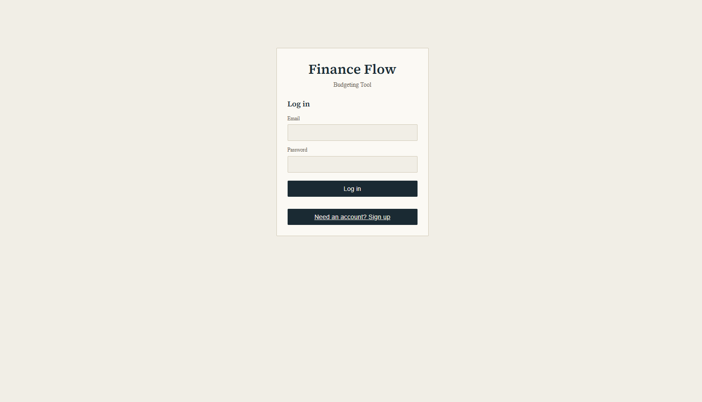
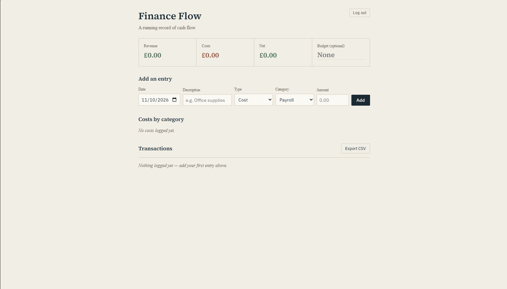
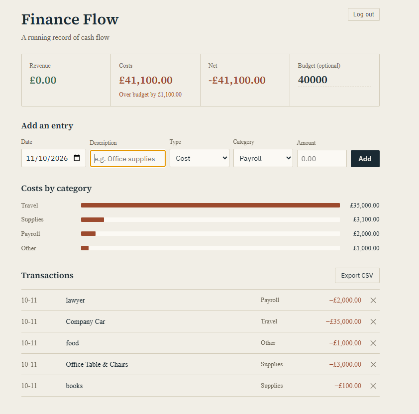

# Finance Flow

A budgeting web app for small businesses. Log revenue and costs, see where the money goes by category, set a budget, and export your data to CSV.

> **Portfolio project.** Please use fake data only.

**Live demo:** [https://13ryanking.github.io/FinanceFlow1/](https://13ryanking.github.io/FinanceFlow1/)

## Screenshots

**Login screen**


**Dashboard**


**Budget Warning**


## Features

- Email and password accounts, with password confirmation on signup
- Email verification before access to the app (Firebase Authentication)
- Per-user cloud storage, so your data follows your account across devices (Cloud Firestore)
- Choose default spending categories or create your own at signup
- Revenue, costs, and net shown at a glance
- Optional budget, with a warning when costs go over it
- Cost breakdown by category
- Confirmation pop-up before deleting a transaction
- CSV export that opens in Excel or Google Sheets
- Responsive layout for desktop and mobile

## Tech stack

- HTML, CSS, and vanilla JavaScript (no framework)
- Firebase Authentication
- Cloud Firestore
- GitHub Pages for hosting

## Project structure

```
├── index.html   # page structure and screens
├── style.css    # styling
└── app.js       # Firebase setup, auth, data, and rendering
```

## Run locally

1. Clone the repo.
2. Open the folder in VS Code and run `index.html` with the Live Server extension.
3. To use your own backend, create a Firebase project, enable Email/Password sign-in and Firestore, publish the security rules below, and replace `firebaseConfig` in `app.js`.

## How it works

1. A user signs up with an email and password (entered twice). Firebase Authentication creates the account and emails a verification link.
2. Until the email is verified, the app shows a verification screen and loads nothing from the database.
3. Once verified, the app loads that user's data from Firestore. First-time users choose default or custom categories, then reach the dashboard.
4. The browser reads and writes Firestore directly. There's no custom backend, and the security rules decide what each user is allowed to do.

## Data structure

```
users/{uid}
├── categories: string[]
├── budget: number
└── entries/{entryId}
    ├── id: number
    ├── date: string
    ├── desc: string
    ├── type: "income" | "expense"
    ├── category: string
    └── amount: number
```

## Security

- Firestore rules only let a signed-in, email-verified user read and write their own data:

```
  match /users/{userId}/{document=**} {
    allow read, write: if request.auth != null
                       && request.auth.uid == userId
                       && request.auth.token.email_verified == true;
  }
```

- The Firebase web config in `app.js` is public by design. Access is controlled by the security rules, not by hiding the key.
- User-entered text is escaped before it is displayed, and CSV exports guard against spreadsheet formula injection.

## What I'd add next

- Edit transactions and manage categories after setup
- Date filtering and monthly views
- Import from CSV
- Emailed one-time codes using Cloud Functions

## What I learned

**Security Rules and per-user data**
Through creating Finance Flow I learned how Fire store keeps each users data separate. The rules run on Google servers 

**A bug I Fixed**
Early on two accounts in the same browser showed the same transactions because data was stored in local storage. Fixing it meant moving to fire store and giving each their own data.

**The Importance of Separating code**
At first when i started all code was in one file but as the code got longer i had to seprate the code into 3 files index.html, app.js and style.css for better management and documentation
